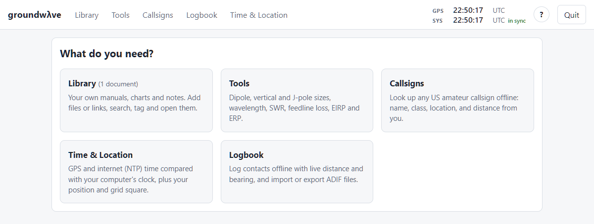

# groundwλve

An offline amateur-radio reference tool, in the spirit of an electronic flight bag: your own manuals, charts and references on your laptop with no signal, plus the small tools you reach for in the field. Named for the radio wave that keeps working without the ionosphere (or the internet).

It is one self-contained program for Windows and Linux. No account, no telemetry, and nothing leaves your computer unless you ask it to.



## Features

- **Document library.** Your own manuals and notes in an ordinary folder: add files or paste a link, search by title and tag, open them in your browser's PDF viewer.
- **Antenna tools.** Dipole, quarter-wave vertical and J-pole lengths, wavelength, SWR, return loss and feedline loss, and power/EIRP/ERP.
- **Offline callsign databases.** Search amateur licenses of the United States and Canada by call sign, name, city, state or province, ZIP or postal code, with distance and bearing from your grid square. Each list is downloaded by you, from the FCC or ISED Canada, when you press a button; no street addresses or phone numbers are kept.
- **Logbook.** Log contacts locally, search them, and import or export ADIF 3.1.4 files.
- **Time & Location.** GPS time and position from a USB receiver, compared with your system clock and internet time, so you know whether your clock is good enough for FT8 and FT4.
- **Built-in user guide**, available offline.

## Download and install

Download the file for your system from the [Releases page](https://github.com/kd9psm/groundwave/releases):

- **Windows:** `groundwave-windows-amd64.exe`. Double-click to run. The app opens in its own window (it needs the WebView2 runtime, which is already on Windows 11 and current Windows 10). Because the file is unsigned, Windows may show "Windows protected your PC": choose **More info**, then **Run anyway**.
- **Linux:** the `.tar.gz` that matches `uname -m` (`x86_64` for PCs, `aarch64` or `armv7l` for Raspberry Pi). Unpack it and run `./groundwave/groundwave` from a terminal. It opens in your default browser; stop it with the **Quit** button or Ctrl+C. To use a USB GPS receiver you need to be in the `dialout` (or `uucp`) group.

Each release lists SHA256 checksums in `SHA256SUMS`. To check a download, put it in the same folder as that file and run `sha256sum -c --ignore-missing SHA256SUMS` (Linux) or `Get-FileHash <file>` (Windows PowerShell) and compare. Builds are made by GitHub Actions from the tagged source, and the Windows file carries a build attestation (`gh attestation verify <file> --owner kd9psm`).

Your documents, logbook and settings live in a data folder you can copy to back up. Start with the [user guide](docs/user-guide/user-guide.md).

## Build from source

Requires [Go](https://go.dev/dl/) 1.26 or newer.

```text
go test ./...
go run ./cmd/groundwave          # opens http://127.0.0.1:47321
go build -o groundwave ./cmd/groundwave
```

Release builds and command-line options are covered in [docs/DEVELOPMENT.md](docs/DEVELOPMENT.md).

## Documentation

| | |
|---|---|
| [User guide](docs/user-guide/user-guide.md) | How to use the program, with screenshots |
| [Architecture](docs/ARCHITECTURE.md) | Code layout and security model |
| [Development](docs/DEVELOPMENT.md) | Building, releasing, regenerating the guide |
| [Style guide](docs/STYLE-GUIDE.md) | Product name and writing conventions |
| [Changelog](CHANGELOG.md) | What changed in each version |

## Contributing

Bug reports and ideas are welcome: please open an issue. Pull requests aren't being accepted for now, because the author wants to stay free to license their own code separately. Forking under the GPL is welcome. To build and test your own copy, see [docs/DEVELOPMENT.md](docs/DEVELOPMENT.md).

## Security

Only the latest release is supported. groundwλve listens on localhost only and checks the Host and Origin of every request. To report a vulnerability, use this repository's **Security** tab, then **Report a vulnerability**, which is private. Please don't open a public issue for it. This is a one-person project, so there is no guaranteed response time.

## License

[GNU GPL v3](LICENSE). Copyright (c) 2026 KD9PSM.
