# groundwλve User Guide

groundwλve is an offline reference for amateur radio operators. It keeps your own manuals and notes, a set of antenna calculators, every US callsign, a logbook and a GPS clock on your computer, so it all still works in the field with no internet.

It is one program. There is nothing to install and no account to make. Download it, open it, use it.

> **About the pictures.** The screenshots in this guide were taken with made-up contacts, documents and callsigns, and with a simulated GPS receiver (shown as COM3), because they are meant to show you what the screens look like, not anyone's real log. Your screens will show your own information.

## Contents

1. [Getting Started](#getting-started)
2. [Finding Your Way Around](#finding-your-way-around)
3. [Library](#library)
4. [Tools](#tools)
5. [Callsigns](#callsigns)
6. [Time & Location](#time--location)
7. [Logbook](#logbook)
8. [Your Files and Your Privacy](#your-files-and-your-privacy)
9. [When Something Goes Wrong](#when-something-goes-wrong)

## Getting Started

### Windows

1. Download **groundwave-windows-amd64.exe** and put it wherever you like (the Desktop is fine).
2. Double-click it. The first time, Windows may show a blue **"Windows protected your PC"** box, because the program is new and not yet widely known to Microsoft. Choose **More info**, then **Run anyway**.
3. groundwλve opens in its own window. There is no console window and nothing else to start.

Closing the window quits the program.

You should **not** see a Windows Firewall question. groundwλve only talks to itself on your own computer; it does not open anything to your network.

The window uses Microsoft's Edge WebView2, which is already part of Windows 11 and up-to-date Windows 10. If your Windows 10 does not have it, groundwλve opens in your normal web browser instead. Everything works the same way.

### Linux

1. Download the file that matches your computer. If you are not sure, open a terminal and run `uname -m`:

   | `uname -m` prints | Download | Typical computer |
   |---|---|---|
   | `x86_64` | `groundwave-…-linux-x86_64.tar.gz` | A normal PC or laptop |
   | `aarch64` | `groundwave-…-linux-aarch64.tar.gz` | 64-bit Raspberry Pi |
   | `armv7l` | `groundwave-…-linux-armv7l.tar.gz` | 32-bit Raspberry Pi |

2. Unpack it and run it from a terminal:

   ```
   tar xzf groundwave-*-linux-*.tar.gz
   cd groundwave
   ./groundwave
   ```

3. It prints a web address (normally `http://127.0.0.1:47321`) and opens it in your default browser. If no browser opens, copy the address into one yourself.

On Linux groundwλve runs in a browser tab. Closing the tab does **not** stop the program: press **Ctrl+C** in the terminal, or press **Quit** in the app. It needs nothing else installed, and the same file works on any Linux distribution.

If it says "Permission denied", run `chmod +x groundwave` and try again.

### Where Your Information Is Kept

Your library, logbook and callsign database are ordinary files in a folder named **Groundwave** inside your Documents folder (or in your home folder if you have no Documents folder). To back everything up, copy that folder. To keep it somewhere else, start the program with `--data` and a folder name, or set the `GROUNDWAVE_HOME` environment variable.

## Finding Your Way Around

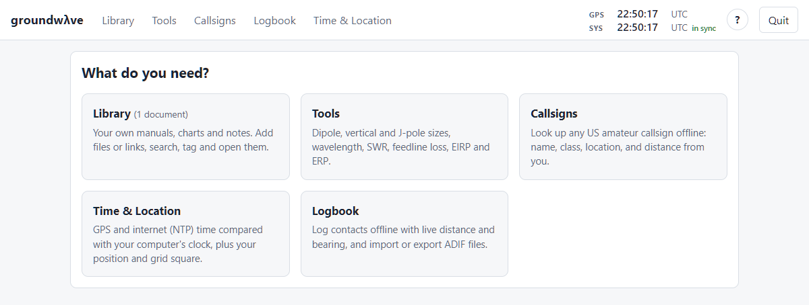

The home page is a menu, and it is what you see when the program starts. Click a tile to go to a feature; after that, use the links across the top of any page to move between features.

The top bar is the same on every page. It has the page links, and on the right, **two clocks**:


- **GPS** (top line) is the time from your GPS receiver, in UTC. If no receiver is connected it shows dashes and a short reason.
- **SYS** (bottom line) is your computer's own clock, in UTC. The small note beside it ("in sync" or "3.5 s slow") appears once you have compared it with internet time (see [Time & Location](#time--location)).

Click the clocks to open the Time & Location page. The **?** button next to them opens a small menu with the program's version and these items: **License (GPL v3)** and **Third-party notices**, which list the open-source software groundwλve is built from; **GitHub repository**, a link to the project's home page; and **Check for updates**. Pressing **Check for updates** asks GitHub (one anonymous request, only when you press it) which release is newest and tells you whether you already have it (or are running a newer test build). If a newer one exists, an **Open the release page** link takes you to the download. The program never downloads or installs an update by itself. **Quit** stops the program. In the Windows app the Quit button is replaced by the window's close button, and you can drag the window by the top bar.

## Library

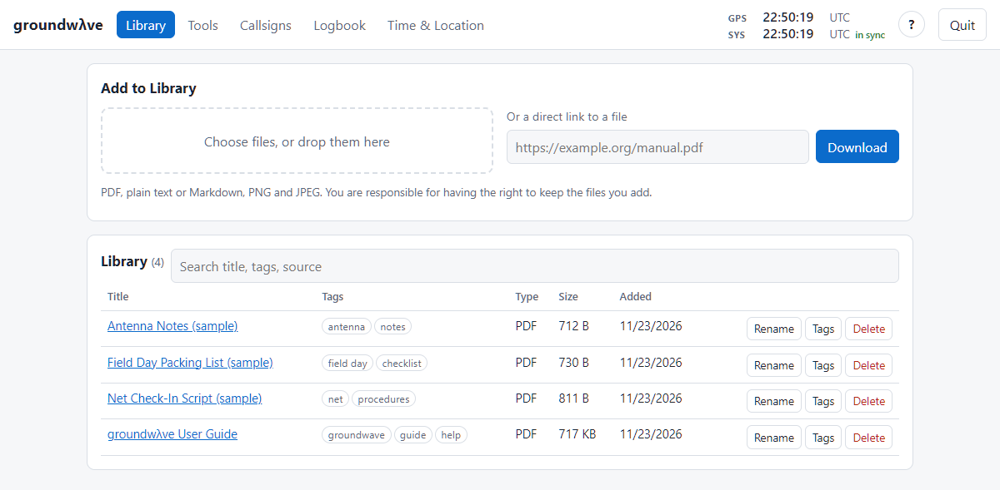

The Library is your own shelf of manuals, charts, checklists and notes. It is a normal folder on your computer, so everything in it is there when you have no signal.

**This guide is already in your Library**, as *groundwλve User Guide*, so you can open it without the internet. If you delete it, it stays deleted; a newer guide that arrives with a program update replaces the older one only while you still have it.

**To add a file:** click the dashed box and pick one or more files, or drag them onto it. groundwλve keeps its own copy, so nothing breaks if you later move or delete the original. It accepts PDF, plain text, Markdown, PNG and JPEG files.

**To add a file from the internet:** paste its direct link into the box on the right and press **Download**. It is fetched once, when you press the button, and the address is remembered with the file.

**To open a document**, click its title. PDFs open in your browser's own viewer.

**To find something**, type in the search box. It looks at titles, tags and the source address as you type:

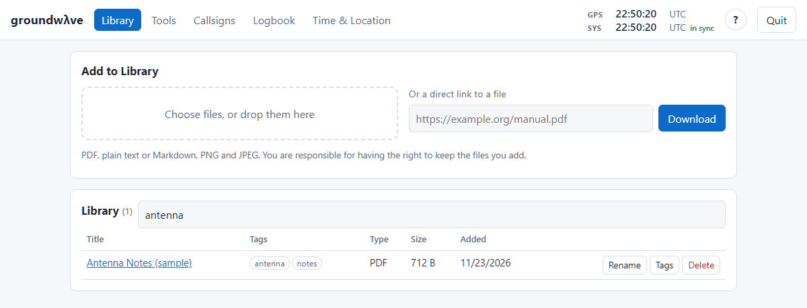

Each row has **Rename**, **Tags** (type words separated by commas) and **Delete**. Delete removes the file from your library.

A few things to know:

- groundwλve does **not** come with other people's manuals. You add the ones you are allowed to keep.
- If you add the same file twice, it tells you it is already there.
- Your library is only searched by title and tags. It does not search the text inside PDFs (that is planned).

## Tools

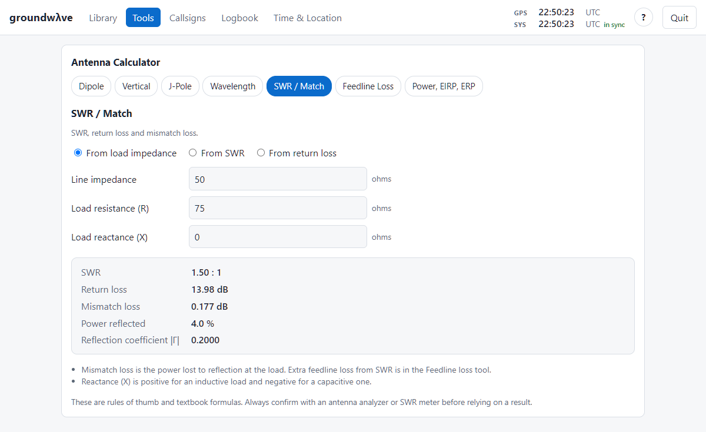

Choose **Tools** in the top menu for the Antenna Calculator: seven calculators, one tab each. Type a number and the answer appears at once. There is no Calculate button, and nothing leaves your computer.

| Tab | What it tells you |
|---|---|
| **Dipole** | Length of a half-wave wire dipole for a frequency, and each leg. |
| **Vertical** | Radiator and radial lengths for a quarter-wave ground-plane vertical. |
| **J-Pole** | Overall length and matching-stub length (you can change the velocity factor for your material). |
| **Wavelength** | Wavelength for a frequency, and the common fractions of it (½, ¼, 5/8…). |
| **SWR / Match** | SWR, return loss, mismatch loss and reflected power. Start from your load's resistance and reactance, from an SWR reading, or from a return-loss reading. |
| **Feedline Loss** | How much power a cable run eats, including the extra loss that a poor SWR adds. |
| **Power, EIRP, ERP** | Convert watts to dBm and dBW, and work out EIRP and ERP from your power, feedline loss and antenna gain. |

Here is the dipole page. Enter your frequency in MHz:

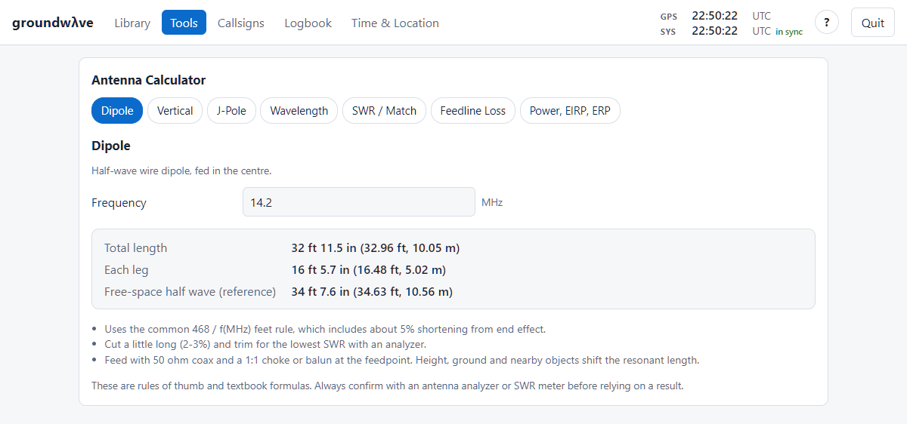

And the feedline calculator. Enter your cable's loss per 100 feet (or metres) from its data sheet, the length in the same units, and your SWR:

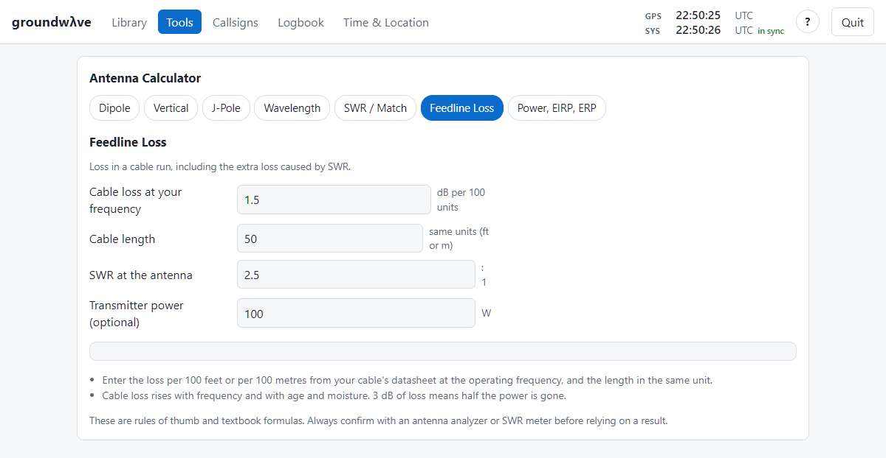

Lengths are shown in feet and inches and in metres. Each tab lists the rule it uses under the answer.

> **These are starting points.** The numbers are textbook formulas and rules of thumb. Height above ground, nearby objects and the wire you use all move the real answer. Cut long, then trim while watching an antenna analyzer or SWR meter.

## Callsigns

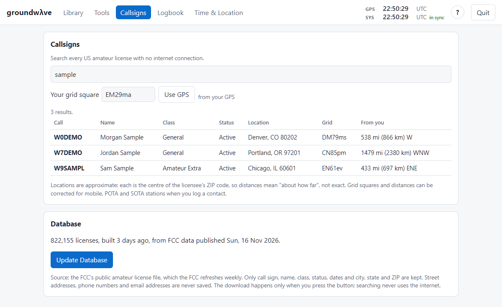

Look up any US amateur licence with no internet connection: the name, licence class, standing, home town, an approximate grid square, and how far away and in which direction they are from you.

### Getting the Database (One Time, Needs Internet)

The first time, the page says there is no database yet. Press **Download Database**. groundwλve downloads the FCC's public amateur licence file (about 200 MB) and builds its own searchable copy. It takes a few minutes and needs roughly 500 MB of free disk space while it works. A progress bar shows how it is going, and **Cancel** stops it, leaving whatever you had before untouched.

After that you never need the internet to search. The FCC refreshes its file weekly, so press **Update Database** now and then if you want newer licences. The page tells you how old your copy is.

Only the call sign, name, class, status, dates and city, state and ZIP code are kept. Street addresses, phone numbers and email addresses are never saved.

### Searching

Type in the big box. Results appear as you type.

| You type | You get |
|---|---|
| `kd9` or `w1aw` | Call signs that start that way (portable endings like `/P` work too) |
| `smith` | People with that name |
| `60013` | Everyone in that ZIP code |
| `cary, il` or `Cary, Illinois` | Everyone in that city and state |
| `call:W9`, `st:IL`, `name:smith`, `city:cary` | Only that kind of match |

### How Far Away Are They?

Type **your grid square** in the box below the search (for example `EN52vf`), or press **Use GPS** to fill it from your receiver. The **From you** column then shows distance and compass direction.

Locations are **approximate**. The FCC file has no street coordinates, so each licence is placed at the centre of its ZIP code. That is fine for "about how far", not for exact positions. A grid square in this table can differ from the operator's real one by a neighbouring square.

### Licence Standing

Licences that ran out within the last two years (the renewal grace period) are listed but greyed, and marked with the date their term ended. When a call sign has been reissued, the current holder is listed first.

## Time & Location

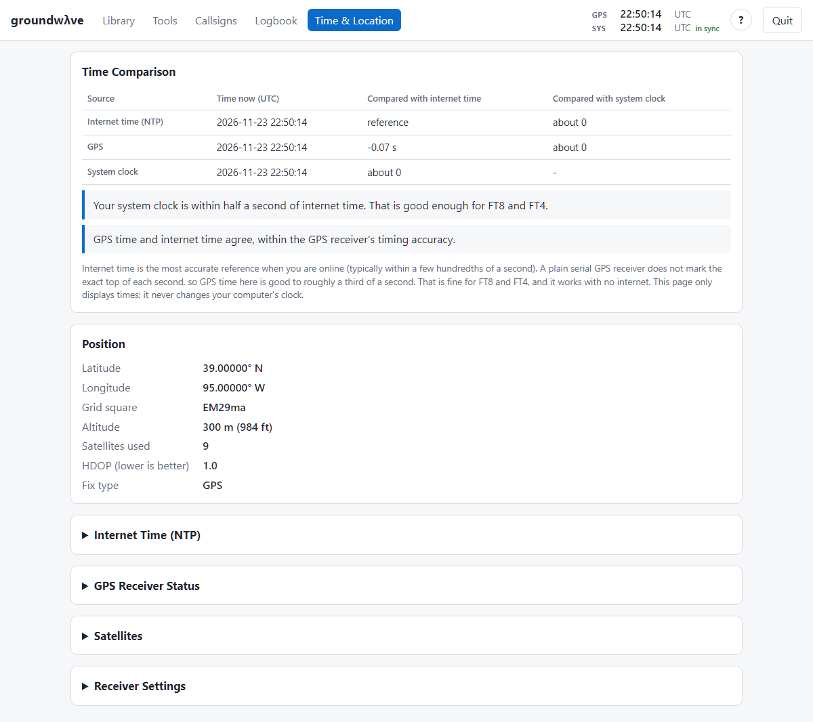

The page is in two halves. The top shows the **time** (the clocks compared) and the **location** (where you are). Below that are four sections that stay folded away until you click their titles: **Internet Time (NTP)**, **GPS Receiver Status**, **Satellites** and **Receiver Settings**. Opened, the last three look like this:

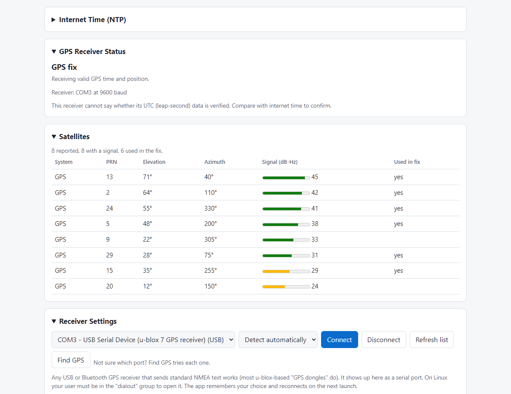

This page compares three clocks, shows where you are, and tells you whether your computer's clock is accurate enough for FT8 and FT4. It only **shows** times: it never changes your computer's clock.

### Connecting a GPS Receiver

Any USB or Bluetooth GPS receiver that sends standard NMEA text will work. Most inexpensive "GPS dongles" do. It appears to your computer as a serial port (COM3, COM4… on Windows, `/dev/ttyUSB0` or `/dev/ttyACM0` on Linux).

1. Plug the receiver in. If you can, put it near a window or outdoors for its first start-up, because it can take a few minutes to find satellites the first time.
2. Go to **Time & Location** and click **Receiver Settings** at the bottom of the page to open it.

   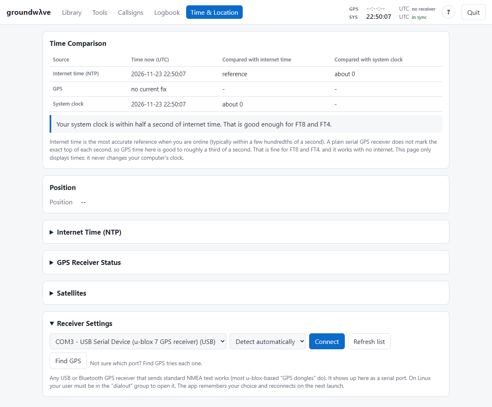

3. Choose your receiver's port from the first list and press **Connect**. Leave the baud rate on *Detect automatically* unless you know otherwise.
4. Not sure which port it is? Press **Find GPS**. It listens briefly on each serial port and offers the one that is sending GPS data. Read the warning first: opening some other devices' ports can make them restart, which is why this only happens when you press the button.

The choice is remembered. The next time you start groundwλve it reconnects by itself, and it reconnects if you unplug and replug the receiver. **Disconnect** forgets it.

**On Linux**, your user must be in the `dialout` group (or `uucp` on some distributions) to open the port. groundwλve warns you at start-up if it sees a USB serial device you are not allowed to use. The fix, followed by logging out and in again, is:

```
sudo usermod -aG dialout $USER
```

If a USB device vanishes the moment you plug it in, the ModemManager service may be grabbing it: `sudo systemctl stop ModemManager`.

### Reading the Page

Always visible:

- **Time Comparison** lists internet time, GPS and your computer's clock side by side, with how far each is from the others, and says in a sentence whether your clock is good enough. FT8 and FT4 need your clock within about half a second.
- **Position** shows latitude, longitude, **grid square**, altitude, how many satellites are in use and the fix quality.

Click a title to open:

- **Internet Time (NTP)** is the optional internet check, described below.
- **GPS Receiver Status** says what state things are in: no receiver chosen, searching for satellites, or fix. It uses plain words ("hears no signal from any satellite: check the antenna's view of the sky") when something is wrong.
- **Satellites** lists each satellite the receiver can hear, how high it is, and its signal strength. A green bar and "yes" mean it is being used.
- **Receiver Settings** is where you choose and connect the receiver.

GPS time here is accurate to about a third of a second, which is fine for the digital modes. If a receiver has only just started, GPS time can be a whole number of seconds out until it has heard the current leap-second count from the satellites (usually within about 15 minutes). The page explains this when it sees it.

### Internet Time (Optional)

Open **Internet Time (NTP)** and press **Check Now** to compare your computer's clock with public internet time servers (Cloudflare, NIST and the NTP Pool). That is the most accurate reference when you are online, usually within a few hundredths of a second.

This is the one thing on the page that uses the internet, so it only happens when you press the button, or if you tick *Also check automatically every 10 minutes* (which is off until you choose it). The servers can see your computer's internet address, as with any website you visit.

If your clock is more than half a second out, fix it in your operating system's date and time settings; groundwλve will not change it for you.

## Logbook

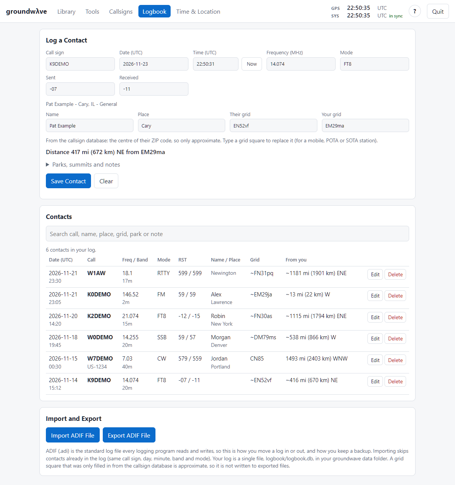

Log your contacts, offline. Your log is a single file on your computer, and nothing is sent anywhere.

### Logging a Contact

1. Start typing the other station's **call sign**. The date and time fill in at once (in UTC, and from the GPS when there is a fix), and groundwλve looks the call up in your callsign database.
2. If it finds them, it fills in **name**, **place** and their **grid square**, and shows the **distance and direction** from you as you type, as in the picture above. Anything you have typed yourself is never overwritten.
3. Fill in the **frequency** (in MHz), **mode** and the signal reports. Frequency tells groundwλve the band.
4. Press **Save Contact**.

The *Now* button resets the time to now. *Parks, summits and notes* opens extra boxes for POTA and SOTA references, yours and theirs, and a note.

### Mobile, Park and Summit Stations

The grid square that comes from the callsign database is where the operator *lives*, so it is wrong for someone who is mobile or portable. If they tell you where they are, just type their grid square over it. Your version is the one that is kept, and the distance updates.

A grid square that was only filled in from the database is shown with a **~** in the list, to mark that it is approximate, and it is **not** written into exported files, because the other operator never told you it.

### Your Own Grid Square

The **Your grid** box fills from your GPS when there is a fix. With no GPS, type it once and groundwλve remembers it.

### The Contact List

Contacts are listed newest first, with the distance and direction from where you are now. Distances are worked out each time, not stored, so they follow you if you move. Type in the search box to find a call sign, name, place, grid square, park or note. **Edit** loads a contact back into the form; **Delete** asks before removing it.

### Importing and Exporting (ADIF)

**ADIF** (a file ending in `.adi`) is the standard log file that every logging program can read and write.

- **Export ADIF File** saves your whole log as a file. **This is your backup**, and the way to take your log to another program or to upload it to a site such as LoTW or QRZ yourself. Export now and then, especially before a trip.
- **Import ADIF File** reads a log from another program. Contacts already in your log (same call, day, minute, band and mode) are skipped, and it tells you how many were added, how many were already there and anything it could not use. An import is all or nothing, so a bad file cannot leave a half-imported log.

Fields groundwλve has no box for are kept and written back out, so a trip through groundwλve loses nothing.

There is no online sync in this version. Sending contacts to QRZ, LoTW, eQSL and similar services is something to do by uploading an exported file for now.

## Your Files and Your Privacy

- groundwλve has **no tracking and no accounts**. It never sends information about you or your computer anywhere.
- It uses the internet **only when you press a button that says so**: adding a document from a link, downloading or updating the callsign database, and checking internet time.
- The program only answers to your own computer. Other computers on your network, and websites in your browser, cannot open it.
- Everything lives in your **Groundwave** folder (see [Where Your Information Is Kept](#where-your-information-is-kept)). Copy that folder to back it up or to move to another computer.

## When Something Goes Wrong

| What you see | What to try |
|---|---|
| **Windows says "Windows protected your PC"** | Choose **More info**, then **Run anyway**. It appears because the program is new and unsigned. |
| **The Windows app opens in a browser instead of its own window** | Your Windows lacks Microsoft's WebView2. Everything still works in the browser. To get the window, install the Microsoft Edge WebView2 Runtime from Microsoft. |
| **"groundwave is already running"** | It is already open (check the taskbar or your browser). Opening it again just shows the running copy. |
| **Linux: "Permission denied"** | Run `chmod +x groundwave`. |
| **Linux: the terminal notes that you are not in the "dialout" group** | See [Connecting a GPS Receiver](#connecting-a-gps-receiver). Log out and in again after the fix. |
| **No receivers in the list, or the receiver is missing** | Unplug and replug it, then press **Refresh list**. Only one program can use a GPS receiver at a time, so close any other program that is using it. |
| **GPS says "searching" and never gets a fix** | The receiver cannot see the sky. Move it to a window or outdoors, away from laptops and USB 3 ports, using a USB extension cable if you need to. The first fix after a long time off can take several minutes. |
| **GPS time differs from internet time by about 2 seconds** | A new receiver sometimes uses an out-of-date leap-second count for its first 15 to 40 minutes. Leave it tracking, then check again. |
| **The callsign page says there is no database** | Press **Download Database** (needs internet, once). |
| **A callsign has no distance** | A few licences are in ZIP codes with no map position (for example PO-box-only ZIPs). Type their grid square in the logbook if you know it. |
| **I closed the browser tab and the program is still running (Linux)** | Press **Quit** in the app, or Ctrl+C in the terminal. |

If it still will not behave, the program prints what it is doing in the terminal on Linux. On Windows, a startup problem appears in a message box.

groundwλve is free software under the GNU General Public License, version 3.
